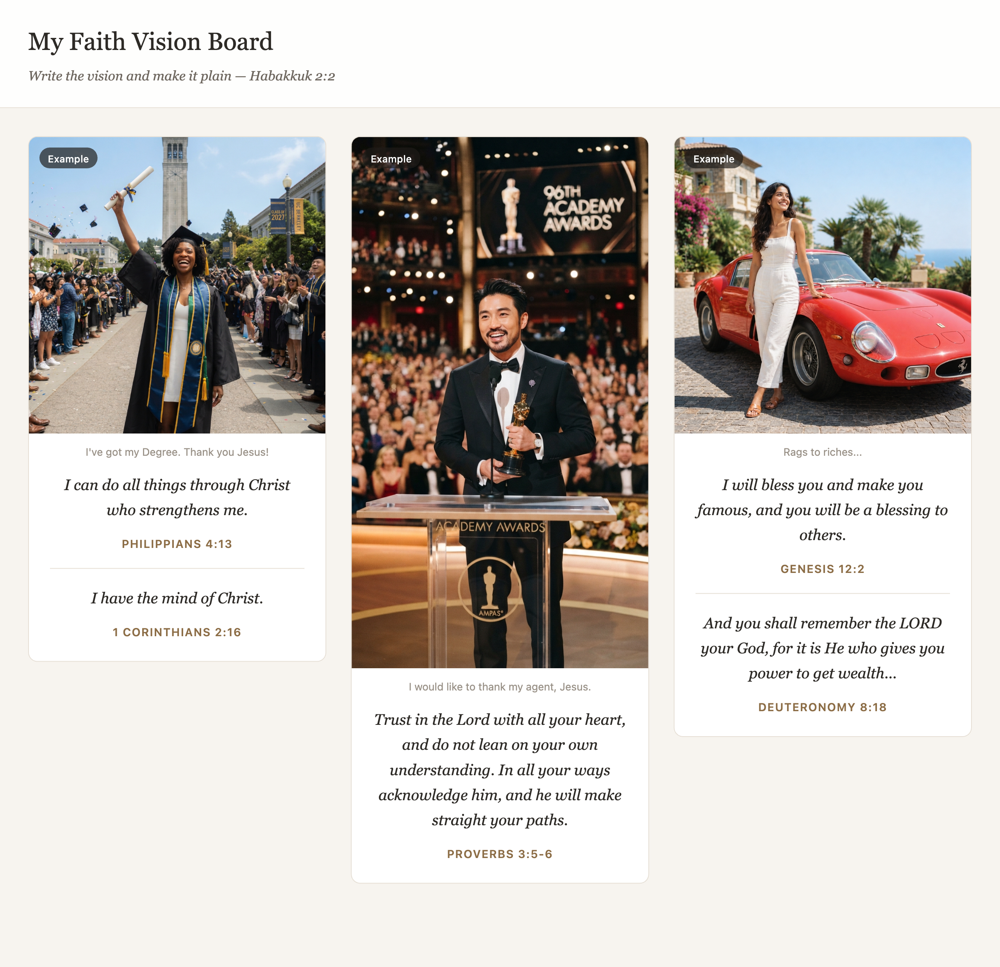

# Faith Vision Board
A faith-based vision board that combines personal goals, visual inspiration and Bible scripture.

Many vision-board products concentrate on manifestation. This app uses visualization in a Christian framework. Instead of collecting images of things they want and then trying to get it through mental effort, users can ground their desires in scripture. This grounding creates a confidence that you will receive what you want because the Bible says it's yours already. This scripturally grounded confident expectation of good is called faith.

Live Demo:<br>
https://vision-board.woza.work/

- Simple to use.
- The board is saved locally in the browser. Users don't need to upload personal photographs and spiritual reflections to an online account.
- Download a photo of the entire vision board.
- Single file web app - html, css and js.

<br>


<p>Simple UI</p>

<br>


<p>Click through images</p>

<br>


<p>Download a picture of the entire board</p>

<br>

## How to run the app
- Downlod the project folder.
- Double click the ```index.html``` file.
- The app will open in your browser.

<br>

## Related Projects
- Faith Scrolling<br>
https://faithscrolling.com/
- The Good News of Jesus Christ in 5 Simple Steps<br>
https://fivejc.com/
- Learn to share your faith<br>
https://goshareyourfaith.com/
- One Minute Gospel<br>
https://github.com/vbookshelf/One-Minute-Gospel
- Gospel Bot<br>
https://gospelbot.com/

<br>

## Revision History

Version 1.2<br>
25-Nov-2026<br>

- Fixed issues flagged in code review.

Version 1.1<br>
25-Nov-2026<br>

- User's can now add multiple scriptures to a vision card.
- Added link to faithscrolling.com
- New cards now appear appear at the end instead of at the beginning.
- Removed the layout change status message.
- Changed two of the example vision cards.


Version 1.0<br>
24-Nov-2026<br>
First release.

<br>

