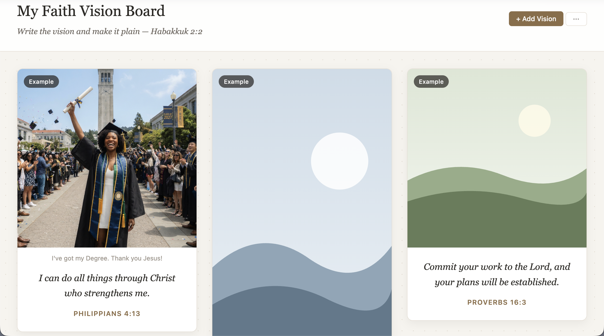

# Faith Vision Board
An online faith vision board that uses local browser storage. Images and data never leave the user's device.

Live Demo: 
https://vision-board.woza.work/

- Simple to use.
- Uses browser storage. No user data sent to the cloud.
- Download a photo of the entire vision board.
- Single file web app - html, css and js.

 

Simple UI

 

Click through images

 

## Related Projects
- Faith Scrolling 
https://faithscrolling.com/
- The Good News of Jesus Christ in 5 Simple Steps 
https://fivejc.com/
- Learn to share your faith 
https://goshareyourfaith.com/
- One Minute Gospel 
https://github.com/vbookshelf/One-Minute-Gospel
- Gospel Bot 
https://gospelbot.com/

 

## Revision History

Version 1.0 
24-Nov-2026 
First release.
