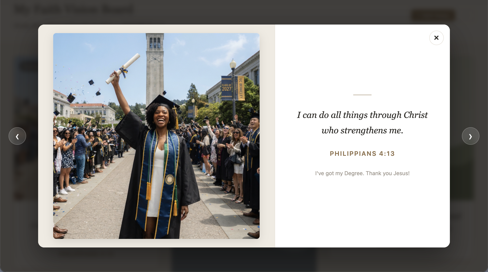

# Faith Vision Board
A faith-based vision board that combines personal goals, visual inspiration and Bible scripture.

Most generic vision-board products concentrate on manifestation, lifestyle goals, motivation and aesthetics. This free app introduces a distinctly Christian framework. Instead of simply collecting images of things someone wants, users can ground those aspirations in scripture. This grounding enables more focused and confident prayer.

Live Demo:<br>
https://vision-board.woza.work/

- Simple to use.
- The board is saved locally in the browser, rather than requiring users to upload personal photographs and spiritual reflections to an online account.
- Download a photo of the entire vision board.
- Single file web app - html, css and js.

<br>


<p>Simple UI</p>

<br>


<p>Click through images</p>

<br>

## How to run the app
- Downlod the project folder.
- Double click the ```index.html``` file.
- The app will open in your browser.

<br>

## Related Projects
- Faith Scrolling<br>
https://faithscrolling.com/
- The Good News of Jesus Christ in 5 Simple Steps<br>
https://fivejc.com/
- Learn to share your faith<br>
https://goshareyourfaith.com/
- One Minute Gospel<br>
https://github.com/vbookshelf/One-Minute-Gospel
- Gospel Bot<br>
https://gospelbot.com/

<br>

## Revision History

Version 1.0<br>
24-Nov-2026<br>
First release.
